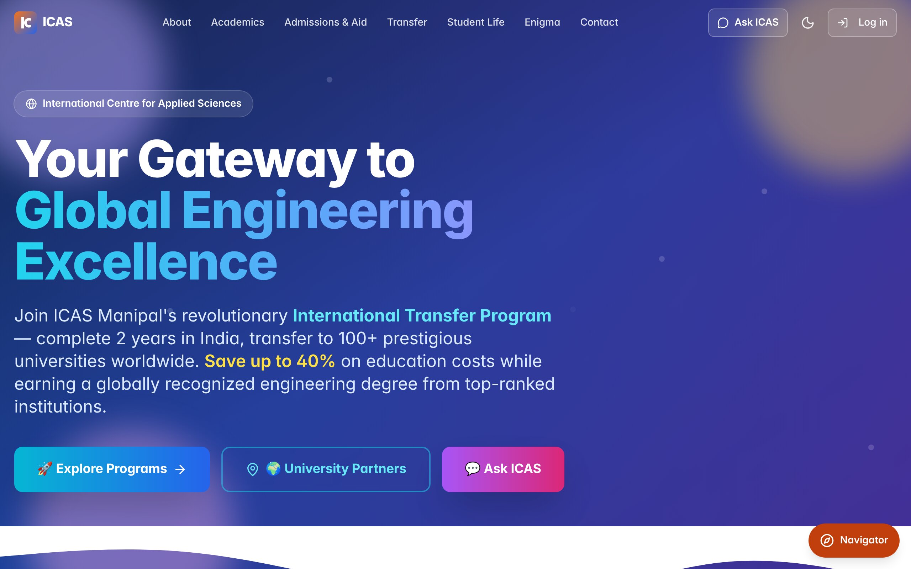
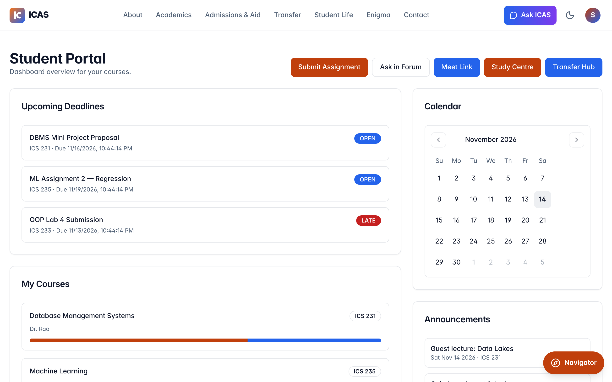
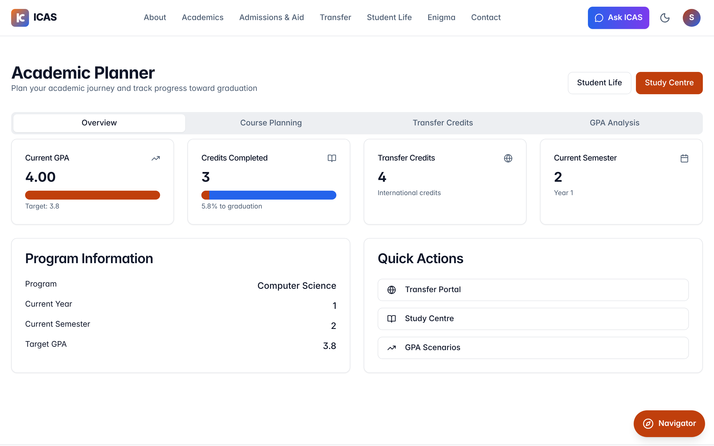
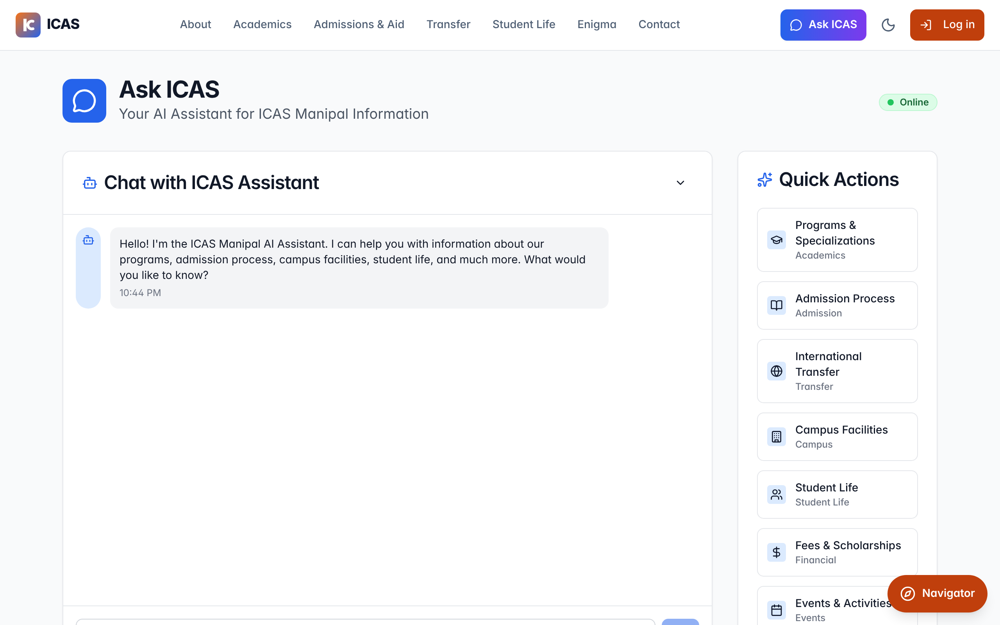
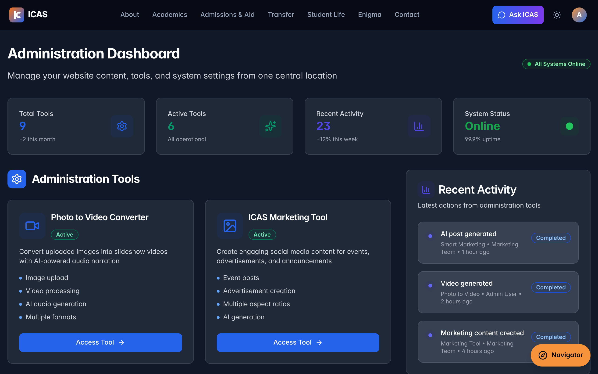
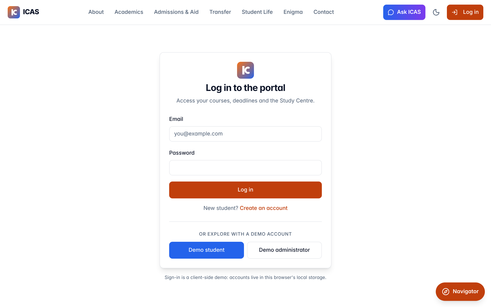
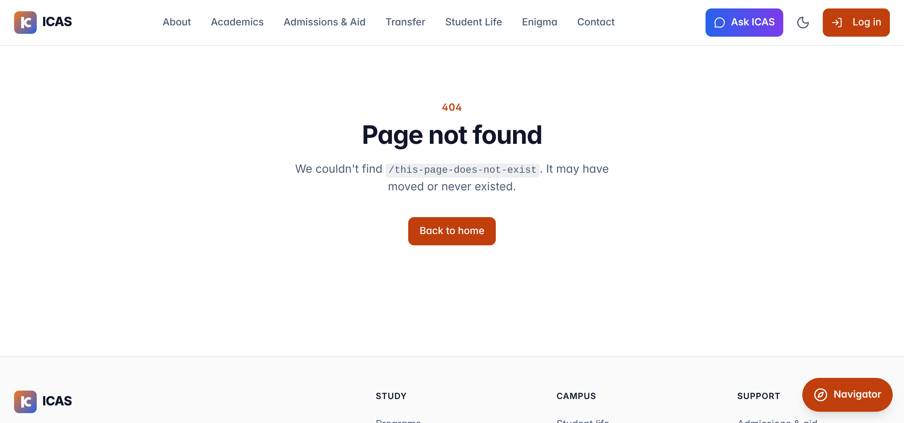
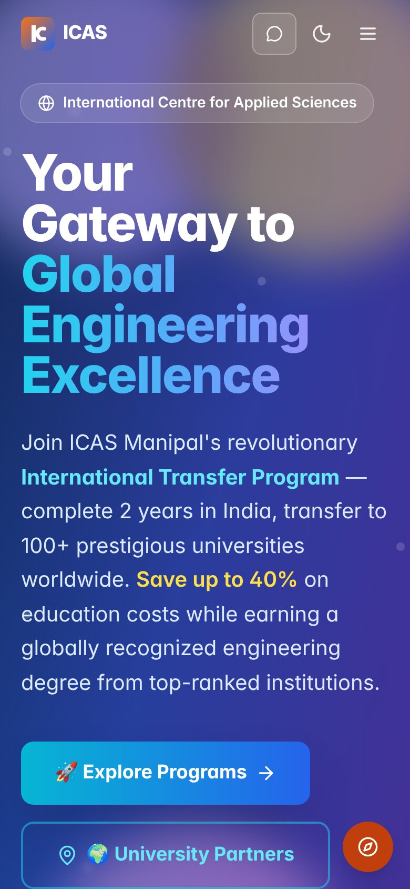
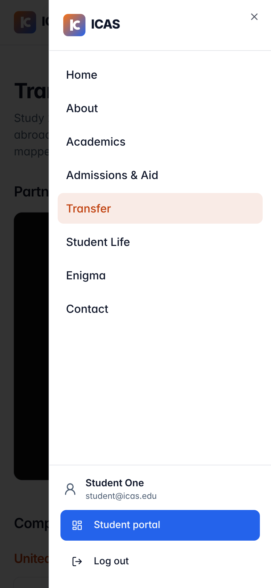
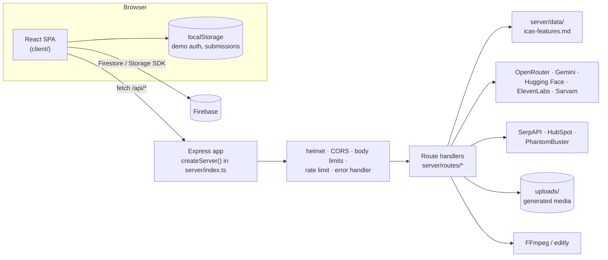

# ICAS Student Life Assistant

**One web app for ICAS Manipal students and staff: transfer guidance, academic planning, an AI
assistant grounded in ICAS information, and AI-assisted tools for the administration team.**




Built by **Team AXION** for the Enigma Hackathon 2025. Original hackathon deployment:
<https://icas-one-stop-solution-zrqdvs.vercel.app/> (it may no longer be online or match this
branch).

---

## Contents

- [Overview](#overview)
- [Screenshots](#screenshots)
- [Features](#features)
- [Tech stack](#tech-stack)
- [Architecture](#architecture)
- [Project structure](#project-structure)
- [Getting started](#getting-started)
- [Configuration](#configuration)
- [Running the app](#running-the-app)
- [Usage](#usage)
- [Scripts](#scripts)
- [API reference](#api-reference)
- [Testing](#testing)
- [Linting and formatting](#linting-and-formatting)
- [Deployment](#deployment)
- [Accessibility and UX](#accessibility-and-ux)
- [Troubleshooting and FAQ](#troubleshooting-and-faq)
- [Known limitations](#known-limitations)
- [Roadmap ideas](#roadmap-ideas)
- [Contributing](#contributing)
- [License](#license)
- [Team](#team)

## Overview

ICAS (International Centre for Applied Sciences, Manipal) runs a **2+2 international transfer
program**: students study for two years in Manipal and then transfer to a partner university
abroad to finish their engineering degree. That means juggling transfer requirements, deadlines,
course planning and alumni contacts, while the staff running the program handle a lot of
repetitive communication: posters, social posts, outreach emails and alumni messages.

This project puts both sides in one place:

- **Students and prospective students** get the program information, a course and GPA planner,
  a student portal and a chat assistant that answers questions from a curated ICAS knowledge
  base.
- **Administrators** get a dashboard of AI-assisted tools for marketing content, outreach,
  alumni messaging and media generation.

It is a hackathon project that has been cleaned up for production use. Some features depend on
third-party APIs and some admin features are still mock or simulated; both are flagged clearly
below.

## Screenshots

All screenshots were taken from a local production build (`pnpm build && pnpm start`) with no
API keys configured, using the built-in demo accounts and sample data.

| Student portal                                           | Academic planner                                                    |
| -------------------------------------------------------- | ------------------------------------------------------------------- |
|  |  |

| Ask ICAS assistant                                   | Administration dashboard (dark theme)                                              |
| ---------------------------------------------------- | ---------------------------------------------------------------------------------- |
|  |  |

| Login with demo accounts                         | 404 page                                          |
| ------------------------------------------------ | ------------------------------------------------- |
|  |  |

<p>
  
  &nbsp;
  
</p>

_Phone layout (390 px wide): the home page and the slide-over navigation menu._

> Program and club photos are loaded from an external image CDN. When it cannot be reached (as
> in the sandbox used for these screenshots) the app shows a neutral placeholder instead.

## Features

### For students

| Area                                      | What it does                                                                                                                                 |
| ----------------------------------------- | -------------------------------------------------------------------------------------------------------------------------------------------- |
| **Home and info pages**                   | Programs, the 2+2 transfer pathway, admissions and aid, financial and medical aid, student life, research, events, news, faculty and contact |
| **Transfer** (`/transfer`)                | Partner universities on a map and a full list grouped by country                                                                             |
| **Ask ICAS** (`/ask-icas`)                | Chat assistant that answers questions about programs, transfers and admissions using `server/data/icas-features.md` + OpenRouter             |
| **Site navigator**                        | Floating keyword-based helper (bottom right) that jumps to the right page; works without any API key                                         |
| **Academic Planner**                      | Overview of GPA and credits, course planning, transfer-credit tracking and GPA scenarios                                                     |
| **Student Life Hub**                      | Academic stats, mentorship, research and community tabs, plus a class timetable                                                              |
| **Student portal** (`/portal`)            | Deadlines, courses with progress, a calendar, announcements and grades; course pages with assignment submission (stored in the browser)      |
| **Study Centre** (`/portal/study-centre`) | Per-course notes, syllabus and file uploads stored in Firebase (Firestore + Storage); shows a clear notice when Firebase is not configured   |
| **Light and dark themes**                 | Follows the system setting, with a toggle in the header that is remembered per browser                                                       |

### For administrators (`/administration`, admin role)

| Tool                       | What it does                                                                                                        | External services                            |
| -------------------------- | ------------------------------------------------------------------------------------------------------------------- | -------------------------------------------- |
| **Photo to Video**         | Turns uploaded photos into a slideshow video, with an optional AI script and voice-over                             | FFmpeg, Hugging Face, ElevenLabs, OpenRouter |
| **Marketing Tool**         | Festival and announcement post builder with logo upload. **Generation is currently simulated** (placeholder images) | none                                         |
| **Smart Marketing**        | Writes Instagram-style posts and generates images, optionally from uploaded reference images                        | Google Gemini, OpenRouter                    |
| **Content Management**     | Drafts and optimises blog and social content and searches for content ideas                                         | OpenRouter, SerpAPI                          |
| **Outreach Management**    | Researches a college, company or person and drafts an outreach email                                                | OpenRouter, SerpAPI                          |
| **Alumni Automation**      | Generates personalised alumni messages and hands them to LinkedIn and CRM automation                                | OpenRouter, PhantomBuster, HubSpot           |
| **Social Media Analytics** | Dashboard for account and engagement stats. **Currently backed by mock data**                                       | none                                         |
| **Delegate summaries**     | Transcribes an uploaded session recording and summarises it                                                         | Sarvam AI, OpenRouter                        |

Every integration is optional. When a key is missing, the related endpoint either returns demo
data or responds with `503` and an explanatory error, and the rest of the site keeps working.

> **Demo authentication.** Sign-in is handled entirely in the browser
> (`client/context/AuthContext.tsx`) with seeded demo accounts stored in `localStorage`. It gates
> the UI only; **the API itself is not authenticated**. Put real authentication in front of the
> `/api` routes before exposing the admin tools publicly.

## Tech stack

| Layer               | Technology                                                                                                        |
| ------------------- | ----------------------------------------------------------------------------------------------------------------- |
| UI framework        | React 18, React Router 6, TypeScript 5                                                                            |
| Build and dev       | Vite 7 with `@vitejs/plugin-react-swc`                                                                            |
| Styling             | Tailwind CSS 3 with CSS-variable design tokens, `tailwindcss-animate`, Inter font                                 |
| Components          | Radix UI primitives (shadcn/ui-style kit in `client/components/ui`), lucide-react icons, Sonner toasts            |
| Charts and data     | Recharts, TanStack Query, react-day-picker                                                                        |
| Backend             | Express 5, Zod, Multer, helmet, CORS, compression, express-rate-limit, morgan                                     |
| Data                | Firebase Firestore + Storage (Study Centre); `localStorage` (demo auth, submissions); `uploads/` on disk          |
| AI and integrations | OpenRouter, Google Gemini (`@google/genai`), Hugging Face, ElevenLabs, Sarvam AI, SerpAPI, HubSpot, PhantomBuster |
| Media               | FFmpeg, optional `editly`                                                                                         |
| Testing             | Vitest, Supertest                                                                                                 |
| Code quality        | ESLint 9 (flat config, typescript-eslint, react-hooks), Prettier 3                                                |
| Hosting             | Node server, Vercel (`vercel.json`) or Netlify (`netlify.toml`)                                                   |

## Architecture



`createServer()` builds one Express app that is reused in every environment:

| Environment       | Entry point                | How it runs                                                                     |
| ----------------- | -------------------------- | ------------------------------------------------------------------------------- |
| Development       | `vite.config.ts`           | A Vite plugin mounts the Express app as middleware; SPA and API share port 8080 |
| Production (Node) | `server/node-build.ts`     | Serves `dist/spa`, the API, and falls back to `index.html` for client routes    |
| Vercel            | `api/index.ts`             | Wraps the app with `serverless-http` as a serverless function                   |
| Netlify           | `netlify/functions/api.ts` | Same, as a Netlify function                                                     |

Other design points:

- **Hardening.** Security headers (helmet), configurable CORS, request size limits, rate limiting
  on mutating `/api` requests, JSON 404s for unknown API routes, a central error handler that hides
  internals, and path validation (`server/lib/safe-path.ts`) so client-supplied file names can
  only resolve inside `uploads/`.
- **Code splitting.** Every route except the home and 404 pages is loaded with `React.lazy`, so
  each page downloads only its own bundle.
- **Design tokens.** Colours, radius and the dark theme are CSS variables in
  `client/global.css`, consumed through `tailwind.config.ts`. Light-mode text on the primary and
  secondary colours meets WCAG AA (at least 4.5:1).

## Project structure

```
.
├── client/                      React single-page app
│   ├── App.tsx                  Providers, router and lazy-loaded routes
│   ├── global.css               Design tokens (light/dark), base styles, focus and motion rules
│   ├── pages/                   One component per route (Index, Transfer, Portal, Administration…)
│   ├── components/
│   │   ├── layout/              Header (desktop nav + mobile menu), Footer, SiteLayout, nav items
│   │   ├── brand/               SVG logo
│   │   ├── theme/               Theme provider and toggle
│   │   ├── auth/                Route guards (Protected, RequireRole)
│   │   ├── ai/                  Ask ICAS chat and the floating site navigator
│   │   ├── admin/               Content, outreach and alumni automation tools
│   │   ├── sections/            Reusable page sections (partners, timetable, alumni…)
│   │   └── ui/                  Radix-based component kit (button, card, tabs, sheet…)
│   ├── context/AuthContext.tsx  Demo authentication backed by localStorage
│   ├── data/sample.ts           Static content and demo users
│   └── lib/                     Firebase setup, Study Centre data access, redirect guard, utils
├── server/
│   ├── index.ts                 createServer(): middleware, routes, error handling
│   ├── node-build.ts            Production entry (static SPA + API + history fallback)
│   ├── config.ts                Environment-driven configuration
│   ├── data/icas-features.md    Knowledge base used by Ask ICAS
│   ├── lib/                     Path safety, text cleaning, Gemini client (+ unit tests)
│   └── routes/                  One handler module per feature
├── shared/                      Types shared by client and server
├── api/index.ts                 Vercel serverless entry
├── netlify/functions/api.ts     Netlify function entry
├── public/                      Favicons, robots.txt, static assets
├── docs/                        Feature guides and README screenshots
├── scripts/smoke/               Manual end-to-end smoke scripts
├── .env.example                 Every supported environment variable, documented
├── vite.config.ts               Client build + dev server (mounts Express)
├── vite.config.server.ts        Server bundle for `pnpm start`
└── vitest.config.ts             Test configuration
```

## Getting started

### Prerequisites

| Tool    | Version                  | Notes                                                                   |
| ------- | ------------------------ | ----------------------------------------------------------------------- |
| Node.js | 20 or newer (CI uses 22) | `engines.node` in `package.json`                                        |
| pnpm    | 10                       | Run `corepack enable` and the pinned version is picked up automatically |
| FFmpeg  | any recent version       | Optional, only for the Photo to Video tool                              |
| Git     | any                      |                                                                         |

### Installation

```bash
# 1. Clone
git clone https://github.com/jeevithg090/ICAS-Presentation.git
cd ICAS-Presentation

# 2. Install dependencies (uses the committed lockfile)
corepack enable
pnpm install

# 3. Create your environment file. Every key is optional.
cp .env.example .env

# 4. Start the dev server
pnpm dev
```

Open <http://localhost:8080>. The whole site works without any keys; only the AI and
integration features need them.

## Configuration

All variables live in [`.env.example`](.env.example) with comments. Copy it to `.env` and fill in
only what you need. `.env` is git-ignored; never commit it.

| Variable                            | Required?        | Default                                         | Description                                                                              |
| ----------------------------------- | ---------------- | ----------------------------------------------- | ---------------------------------------------------------------------------------------- |
| `PORT`                              | No               | `3000`                                          | Port for `pnpm start`. `pnpm dev` always uses 8080                                       |
| `NODE_ENV`                          | No               | `development`                                   | Node environment                                                                         |
| `CORS_ORIGIN`                       | No               | empty (any origin)                              | Comma-separated allowed origins; empty or `*` allows all                                 |
| `JSON_BODY_LIMIT`                   | No               | `5mb`                                           | Maximum JSON request body size                                                           |
| `RATE_LIMIT_WINDOW`                 | No               | `900000` (15 min)                               | Rate-limit window in ms for POST/PUT/DELETE under `/api`                                 |
| `RATE_LIMIT_MAX`                    | No               | `100`                                           | Requests allowed per client IP per window                                                |
| `TRUST_PROXY`                       | No               | `1` on Vercel/Netlify, otherwise `false`        | Express `trust proxy` setting (true, false, hop count or subnet list)                    |
| `PING_MESSAGE`                      | No               | `ping`                                          | Response body for `GET /api/ping`                                                        |
| `OPENROUTER_API_KEY`                | For AI           | none                                            | Ask ICAS, transfer assistant, content/outreach/alumni drafting, video scripts, summaries |
| `GOOGLE_API_KEY`                    | For AI           | none                                            | Smart Marketing image generation (Gemini)                                                |
| `HUGGING_FACE_TOKEN`                | For AI           | none                                            | AI video generation                                                                      |
| `VIDEO_MODEL`                       | No               | `stabilityai/stable-video-diffusion-img2vid-xt` | Hugging Face model for video generation                                                  |
| `ELEVENLABS_API_KEY`                | For AI           | none                                            | AI voice-over                                                                            |
| `AUDIO_MODEL`                       | No               | built-in ElevenLabs voice ID                    | ElevenLabs voice ID                                                                      |
| `SARVAM_API_KEY`                    | For AI           | none                                            | Speech-to-text for delegate summaries                                                    |
| `SERP_API_KEY`                      | Optional         | none                                            | Web search for content ideas and outreach                                                |
| `HUBSPOT_API_KEY`                   | Optional         | none                                            | HubSpot private-app token for alumni CRM records                                         |
| `PHANTOMBUSTER_API_KEY`             | Optional         | none                                            | PhantomBuster API key for LinkedIn message automation                                    |
| `PHANTOMBUSTER_PHANTOM_ID`          | Optional         | none                                            | ID of the PhantomBuster phantom to launch                                                |
| `UPLOAD_DIR`                        | No               | `uploads`                                       | Directory for uploaded and generated files                                               |
| `MAX_FILE_SIZE`                     | No               | `10485760` (10 MB)                              | Maximum upload size in bytes                                                             |
| `VITE_FIREBASE_API_KEY`             | For Study Centre | none                                            | Firebase web config. All `VITE_FIREBASE_*` values are exposed to the browser by design   |
| `VITE_FIREBASE_AUTH_DOMAIN`         | For Study Centre | none                                            | Firebase web config                                                                      |
| `VITE_FIREBASE_PROJECT_ID`          | For Study Centre | none                                            | Firebase web config                                                                      |
| `VITE_FIREBASE_STORAGE_BUCKET`      | For Study Centre | none                                            | Firebase web config                                                                      |
| `VITE_FIREBASE_MESSAGING_SENDER_ID` | For Study Centre | none                                            | Firebase web config                                                                      |
| `VITE_FIREBASE_APP_ID`              | For Study Centre | none                                            | Firebase web config                                                                      |
| `VITE_FIREBASE_MEASUREMENT_ID`      | No               | none                                            | Firebase Analytics measurement ID                                                        |

`VITE_*` variables are baked into the client bundle at build time, so rebuild after changing them.
Protect Firebase data with security rules and restrict the web API key to your domains.

## Running the app

### Development

```bash
pnpm dev
```

Vite serves the SPA with hot reload and mounts the Express API on the same port
(<http://localhost:8080>). Server code changes are picked up on reload.

### Production (Node)

```bash
pnpm build        # builds dist/spa (client) and dist/server (Node bundle)
pnpm start        # serves both on PORT (default 3000)
```

Check it is up:

```bash
curl http://localhost:3000/api/ping
# {"message":"ping"}
```

## Usage

### Walkthrough

1. **Browse as a visitor.** Open the home page and use the header (or the menu button on a phone)
   to reach Academics, Admissions & Aid, Transfer, Student Life and the other pages. The compass
   button in the bottom-right corner opens the **site navigator**: type something like
   `financial aid` or `events` and pick a destination.
2. **Log in with a demo account.** Click **Log in**, then **Demo student** or
   **Demo administrator**. You can also sign in manually or create a student account; accounts are
   stored in your browser.

   | Role          | Email              | Password  | Lands on  |
   | ------------- | ------------------ | --------- | --------- |
   | Student       | `student@icas.edu` | `icas123` | `/portal` |
   | Professor     | `prof@icas.edu`    | `icas123` | `/portal` |
   | Administrator | `admin@icas.edu`   | `icas123` | `/admin`  |

3. **Student portal.** See upcoming deadlines, course progress, a calendar and announcements.
   Open a course from **My Courses** to view its syllabus and submit an assignment (saved locally).
   The **Study Centre** needs the `VITE_FIREBASE_*` variables; without them it explains what to
   configure.
4. **Plan your degree.** `/academic-planner` and `/student-life` show GPA, credits, transfer
   credits and planning tabs.
5. **Ask ICAS.** With `OPENROUTER_API_KEY` set, `/ask-icas` answers free-text questions and offers
   one-click quick questions. Without the key it shows an error explaining that the assistant is
   not configured.
6. **Administration tools.** As an administrator, open the account menu (top right) and choose
   **Administration tools**. Each card opens one tool; tools whose keys are missing report that
   they are not configured or return demo data.
7. **Theme.** Use the moon/sun button in the header to switch between light and dark themes.

### API examples

The examples below were run against a local production build with no keys configured.

```bash
# Health check
curl http://localhost:3000/api/ping
# {"message":"ping"}

# Service health for the outreach tool
curl http://localhost:3000/api/outreach/health
# {"status":"healthy","services":{"openrouter":"not_configured","mcp_servers":"available"},"timestamp":"…"}

# Ask ICAS (needs OPENROUTER_API_KEY)
curl -X POST http://localhost:3000/api/ask-icas \
  -H "Content-Type: application/json" \
  -d '{"question":"What is the 2+2 program?"}'
# without a key → 503 {"error":"Ask ICAS not configured - missing OpenRouter API key"}
# with a key    → 200 {"answer":"…"}

# Social media accounts (mock data)
curl http://localhost:3000/api/social-media/accounts
# {"success":true,"data":[{"id":"1","platform":"twitter","username":"icas_university",…}]}

# Validation errors are 400s
curl -X POST http://localhost:3000/api/alumni/generate-message \
  -H "Content-Type: application/json" -d '{}'
# 400 {"error":"Invalid input data"}

# Unknown API routes return JSON
curl http://localhost:3000/api/does-not-exist
# 404 {"error":"Not found"}
```

## Scripts

| Command             | Description                                                          |
| ------------------- | -------------------------------------------------------------------- |
| `pnpm dev`          | Vite dev server with the Express API on port 8080                    |
| `pnpm build`        | Build the SPA (`dist/spa`) and the Node server (`dist/server`)       |
| `pnpm build:client` | Build only the SPA                                                   |
| `pnpm build:server` | Build only the Node server bundle                                    |
| `pnpm start`        | Run the production build (`PORT`, default 3000)                      |
| `pnpm test`         | Run the Vitest suite once                                            |
| `pnpm test:watch`   | Run Vitest in watch mode                                             |
| `pnpm typecheck`    | TypeScript type-check (`tsc`)                                        |
| `pnpm lint`         | ESLint                                                               |
| `pnpm lint:fix`     | ESLint with auto-fix                                                 |
| `pnpm format`       | Format everything with Prettier                                      |
| `pnpm format:check` | Check formatting without writing                                     |
| `pnpm vercel-build` | Build used by Vercel (client only; the API is a serverless function) |

Manual smoke scripts that call a running server live in `scripts/smoke/`:

```bash
BASE_URL=http://localhost:8080 node scripts/smoke/outreach.mjs
BASE_URL=http://localhost:8080 node scripts/smoke/phantombuster.mjs
```

## API reference

All routes are under `/api`. **None of them require authentication** (see
[Known limitations](#known-limitations)). POST, PUT and DELETE requests are rate-limited per IP.

| Method | Path                                             | Auth | Description                                                                  |
| ------ | ------------------------------------------------ | ---- | ---------------------------------------------------------------------------- |
| GET    | `/api/ping`                                      | None | Health check, returns `PING_MESSAGE`                                         |
| GET    | `/api/demo`                                      | None | Example endpoint                                                             |
| POST   | `/api/ask-icas`                                  | None | Ask ICAS chat: `{ question, context?, conversationHistory? }` → `{ answer }` |
| POST   | `/api/transfer/assistant`                        | None | Transfer Q&A: `{ question, context? }`                                       |
| POST   | `/api/photo-to-video/upload`                     | None | Upload images (multipart)                                                    |
| POST   | `/api/photo-to-video/process-video`              | None | Start a slideshow render job                                                 |
| POST   | `/api/photo-to-video/generate-script`            | None | AI narration script                                                          |
| POST   | `/api/photo-to-video/generate-audio`             | None | AI voice-over                                                                |
| POST   | `/api/photo-to-video/add-background-music`       | None | Add background music to a rendered video                                     |
| POST   | `/api/photo-to-video/mix-ai-audio`               | None | Mix AI voice-over into a video                                               |
| GET    | `/api/photo-to-video/status/:jobId`              | None | Render job status                                                            |
| GET    | `/api/photo-to-video/audio-status/:audioJobId`   | None | Audio job status                                                             |
| GET    | `/api/photo-to-video/download/:jobId`            | None | Download the video                                                           |
| GET    | `/api/photo-to-video/stream/:jobId`              | None | Stream the video                                                             |
| GET    | `/api/photo-to-video/preview/:jobId`             | None | Preview the video                                                            |
| GET    | `/api/photo-to-video/audio/:jobId`               | None | Stream the generated audio                                                   |
| POST   | `/api/marketing-tool/generate`                   | None | Generate a post (simulated)                                                  |
| POST   | `/api/marketing-tool/upload-logo`                | None | Upload a logo (multipart)                                                    |
| GET    | `/api/marketing-tool/festivals`                  | None | Festival presets                                                             |
| GET    | `/api/marketing-tool/aspect-ratios`              | None | Supported aspect ratios                                                      |
| GET    | `/api/marketing-tool/models`                     | None | Available generation models                                                  |
| GET    | `/api/marketing-tool/status/:jobId`              | None | Generation job status                                                        |
| GET    | `/api/marketing-tool/download/:jobId`            | None | Download generated content                                                   |
| POST   | `/api/smart-marketing/generate-post`             | None | Write an Instagram-style post                                                |
| POST   | `/api/smart-marketing/generate-image`            | None | Generate an image (Gemini)                                                   |
| POST   | `/api/smart-marketing/mix-images`                | None | Combine reference images into a new image                                    |
| GET    | `/api/smart-marketing/test-connection`           | None | Check the Gemini connection                                                  |
| POST   | `/api/smart-marketing/test-image-generation`     | None | Generate a test image                                                        |
| GET    | `/api/smart-marketing/post-types`                | None | Post type presets                                                            |
| GET    | `/api/smart-marketing/reference-images`          | None | List reference images                                                        |
| POST   | `/api/smart-marketing/upload-reference-image`    | None | Upload a reference image (multipart)                                         |
| PUT    | `/api/smart-marketing/reference-images/:imageId` | None | Update reference image metadata                                              |
| DELETE | `/api/smart-marketing/reference-images/:imageId` | None | Delete a reference image                                                     |
| POST   | `/api/alumni/search-linkedin`                    | None | Find an alumnus's LinkedIn profile                                           |
| POST   | `/api/alumni/generate-message`                   | None | Draft a personalised alumni message                                          |
| POST   | `/api/alumni/send-hubspot`                       | None | Create or update a HubSpot contact                                           |
| POST   | `/api/alumni/send-linkedin-message`              | None | Queue a LinkedIn message via PhantomBuster                                   |
| GET    | `/api/alumni/status`                             | None | Automation counters                                                          |
| POST   | `/api/delegate/summary`                          | None | Transcribe and summarise raw `audio/*` (up to 50 MB)                         |
| GET    | `/api/social-media/accounts`                     | None | Tracked accounts (mock)                                                      |
| POST   | `/api/social-media/accounts`                     | None | Add an account (mock)                                                        |
| DELETE | `/api/social-media/accounts/:accountId`          | None | Remove an account (mock)                                                     |
| POST   | `/api/social-media/accounts/:accountId/refresh`  | None | Refresh an account (mock)                                                    |
| GET    | `/api/social-media/posts`                        | None | Recent posts (mock)                                                          |
| GET    | `/api/social-media/analytics`                    | None | Analytics summary (mock)                                                     |
| GET    | `/api/social-media/trends`                       | None | Engagement trends (mock)                                                     |
| POST   | `/api/outreach/search`                           | None | Research a college, company, event or person                                 |
| POST   | `/api/outreach/draft-email`                      | None | Draft an outreach email                                                      |
| GET    | `/api/outreach/health`                           | None | Outreach service status                                                      |
| POST   | `/api/content/generate`                          | None | Generate content                                                             |
| POST   | `/api/content/optimize`                          | None | Optimise existing content                                                    |
| POST   | `/api/content/search-ideas`                      | None | Search for content ideas                                                     |
| GET    | `/api/content/health`                            | None | Content service status                                                       |

Errors are JSON: `{ "error": "message" }`. Expect `400` for invalid input, `404` for unknown
routes, `429` when rate-limited, `503` when a required API key is missing and `500` for unexpected
failures. Errors that reach the central error handler return a generic message; a few feature
handlers include the upstream error message in their 500 response.

## Testing

```bash
pnpm test          # run once
pnpm test:watch    # watch mode
```

The Vitest suite (63 tests across 5 files) needs no API keys and never calls external services:

| File                               | Covers                                                                                                                                                                           |
| ---------------------------------- | -------------------------------------------------------------------------------------------------------------------------------------------------------------------------------- |
| `server/index.test.ts`             | Supertest integration tests: health endpoints, JSON 404s, security headers, malformed JSON, upload validation, missing-key 503s, alumni validation, rate limiting, error handler |
| `server/lib/safe-path.test.ts`     | Path traversal protection for client-supplied file names                                                                                                                         |
| `server/lib/text.test.ts`          | Markdown stripping and text cleaning for AI responses                                                                                                                            |
| `client/lib/safe-redirect.test.ts` | Open-redirect guard for `/login?next=`                                                                                                                                           |
| `client/lib/study-centre.test.ts`  | Study Centre helpers                                                                                                                                                             |

UI changes were also checked by hand in headless Chromium (Playwright) at 375, 768 and 1280 px
wide in light and dark themes: no horizontal scrolling, no console errors, a single `<h1>` and a
page title on every route.

## Linting and formatting

```bash
pnpm lint            # ESLint, 0 errors expected (some `any`/unused-variable warnings remain)
pnpm lint:fix
pnpm format          # Prettier
pnpm format:check
pnpm typecheck
```

ESLint uses a flat config (`eslint.config.js`) with typescript-eslint, react-hooks and
unused-imports. Prettier settings live in `.prettierrc`. The GitHub Actions workflow in
`.github/workflows/ci.yml` runs install, format check, lint, type-check, tests and the build on
pushes to `main` and on pull requests.

## Deployment

### Node server or container

```bash
pnpm install --frozen-lockfile
pnpm build
PORT=3000 pnpm start
```

- Serves the SPA and the API from one process, with an `index.html` fallback for client routes.
- Mount a persistent volume at `uploads/` (or `UPLOAD_DIR`) if generated media must survive
  restarts.
- Install `ffmpeg` on the host for the Photo to Video tool.
- Behind a reverse proxy, set `TRUST_PROXY` so rate limiting sees real client IPs, and set
  `CORS_ORIGIN` to your domain.

### Vercel

`vercel.json` builds the SPA as static files (`dist/spa`) and deploys `api/index.ts` as a Node
serverless function (30 s max duration). The Ask ICAS knowledge base in `server/data/` is bundled
with the function. Set the environment variables in the Vercel dashboard.

### Netlify

`netlify.toml` runs `npm run build:client`, publishes `dist/spa` and redirects `/api/*` to
`netlify/functions/api.ts`. Set the environment variables in the Netlify dashboard.

On serverless hosts the filesystem is ephemeral and the rate limiter is per instance, so long
video renders and uploaded reference images are better suited to the Node deployment.

## Accessibility and UX

- Semantic landmarks (`header`, `nav`, `main`, `footer`), a **Skip to content** link and one
  `<h1>` per page.
- Full keyboard support: visible focus rings everywhere, the mobile menu and site navigator close
  with <kbd>Esc</kbd> and return focus to their trigger.
- Responsive from 375 px phones to wide desktops; touch targets in the header and mobile menu are
  at least 40–44 px.
- WCAG AA colour contrast for text on the primary and secondary colours in both themes.
- Light and dark themes that follow the system preference, with no flash on load.
- `prefers-reduced-motion` disables animations and scroll reveals.
- Labelled form fields, inline error messages with `role="alert"`, loading spinners on submit, and
  not-configured notices for features that need keys.
- Per-page `<title>`, meta description and Open Graph tags; SVG favicon and Apple touch icon.

## Troubleshooting and FAQ

**`pnpm: command not found`**
Run `corepack enable` (ships with Node 20+), then `pnpm install`.

**The dev server is not reachable on port 8080.**
`pnpm dev` always uses 8080. Make sure nothing else is listening there. `pnpm start` uses `PORT`
(default 3000), not 8080.

**Ask ICAS says it is not configured / returns 503.**
Set `OPENROUTER_API_KEY` in `.env` and restart the server.

**The Study Centre says it needs a Firebase project.**
Create a Firebase project with Firestore and Storage enabled, copy its web config into the
`VITE_FIREBASE_*` variables and restart `pnpm dev` (or rebuild for production).

**I get `429 Too Many Requests`.**
You hit the rate limit for POST/PUT/DELETE requests. Raise `RATE_LIMIT_MAX` or `RATE_LIMIT_WINDOW`
for local testing. Behind a proxy, set `TRUST_PROXY` so all users are not counted as one IP.

**Photo to Video fails to render.**
Install FFmpeg and make sure it is on your `PATH`. `editly` is an optional native dependency and
may fail to install on some systems; the server falls back to FFmpeg.

**Refreshing a page like `/portal` gives a 404 in production.**
Use `pnpm start` (which has a history fallback) or the provided Vercel/Netlify configs. A plain
static file server needs its own SPA fallback to `index.html`.

**Images on the home or Enigma page show a placeholder.**
Those photos load from an external CDN. If your network blocks it you will see a neutral
placeholder instead; the rest of the page is unaffected.

**I logged in but got sent back to the login page.**
Sign-in state is stored in `localStorage`. Private browsing modes or blocked site data can clear
it. Clear the `icas_auth_user` and `icas_users` keys to reset the demo accounts.

## Known limitations

- **No real authentication.** Sign-in is a client-side demo and the API is open to anyone who can
  reach it. Add server-side auth (sessions or JWTs) before exposing the admin tools or paid AI
  endpoints.
- **Mock and simulated features.** Social Media Analytics uses mock data and the Marketing Tool's
  generation is simulated.
- **Browser-only data.** Demo accounts, portal submissions and assignment uploads live in
  `localStorage` and are not shared between devices.
- **External images.** Program and club photos depend on a third-party CDN.
- **Remaining audit advisories.** Most remaining `pnpm audit` findings are in the optional native
  `editly` dependency or dev tooling; one is in React Router 6 and needs a v7 upgrade.
- **Lint warnings.** ESLint reports warnings (mostly `any` and unused variables) that are kept as
  warnings on purpose; there are no errors.
- **Sample content.** Contact details, statistics, events and faculty are sample data for the
  demo and should be replaced with verified information before launch.

## Roadmap ideas

- Server-side authentication and role checks on every `/api` route
- Persist portal data (submissions, planner choices) in Firebase instead of `localStorage`
- Real Social Media Analytics via platform APIs
- Self-host program and club images
- Upgrade to React Router 7 and enable TypeScript `strict` mode
- End-to-end tests (Playwright) for the main student and admin flows
- Internationalisation for prospective students outside India

## Contributing

1. Fork the repository and create a branch from `main`.
2. `pnpm install`, then make your change.
3. Before opening a pull request, make sure these pass:

   ```bash
   pnpm format:check && pnpm lint && pnpm typecheck && pnpm test && pnpm build
   ```

4. Use [Conventional Commits](https://www.conventionalcommits.org/) (`feat:`, `fix:`, `docs:`,
   `style:`, `refactor:`, `test:`, `chore:`).
5. For UI changes, check the page at phone (375 px) and desktop widths in both themes, and include
   a screenshot in the pull request.

Feature-specific guides are in [`docs/`](docs/): [Ask ICAS](docs/ask-icas.md),
[Administration](docs/administration.md), [Alumni Automation](docs/alumni-automation.md),
[Outreach](docs/outreach-management.md), [PhantomBuster](docs/phantombuster-setup.md),
[Social media](docs/social-media-integration.md), [MCP integration](docs/mcp-integration.md) and
[environment setup](docs/environment-setup.md).

## License

No license file has been added yet, so all rights are reserved by default and others cannot
legally reuse the code. If you want it to be open source, the
[MIT License](https://choosealicense.com/licenses/mit/) is a common, permissive choice for
portfolio and hackathon projects.

## Team

Built by **Team AXION** for the Enigma Hackathon 2025:
Jeevith · Shiva Teja · Ali · Charan · Hitesh
