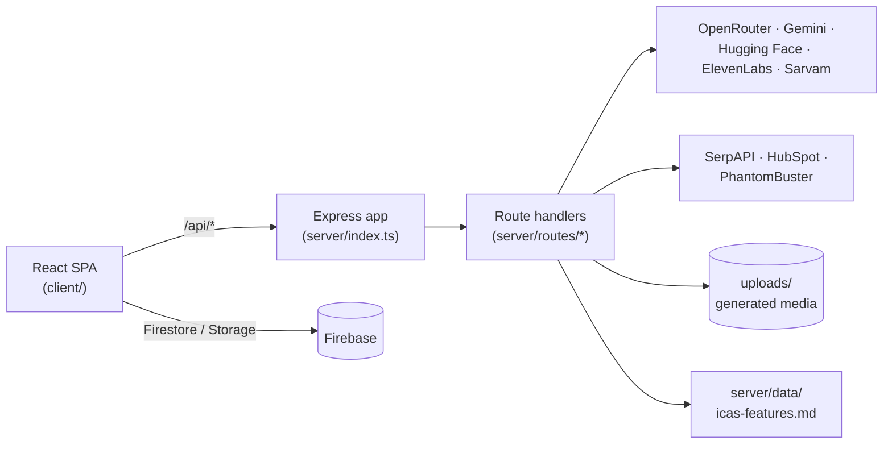

# ICAS Student Life Assistant

A web platform for **ICAS Manipal** (International Centre for Applied Sciences). It brings
together guidance for students on the 2+2 international transfer program, an AI assistant
grounded in ICAS information, and a set of AI-assisted tools for the administration team
(marketing content, outreach, alumni messaging, media generation).

Built by **Team AXION** for the Enigma Hackathon 2025. Original hackathon deployment:
<https://icas-one-stop-solution-zrqdvs.vercel.app/>

---

## Why

ICAS students spend two years in Manipal and then transfer to a partner university abroad.
That means juggling transfer requirements, deadlines, course planning and alumni contacts,
while the staff running the program handle a lot of manual communication. This project puts
the student-facing information and the staff tooling in one React + Express app.

## Features

### For students

| Area                                      | What it does                                                                                                                     |
| ----------------------------------------- | -------------------------------------------------------------------------------------------------------------------------------- |
| **Ask ICAS** (`/ask-icas`)                | Chat assistant that answers questions about programs, transfers and admissions, using a curated ICAS knowledge base + OpenRouter |
| **Transfer & academics pages**            | Transfer pathways, academics, admissions/aid, student life, events, faculty and contact information                              |
| **Academic Planner**                      | Plan your course journey and track progress toward graduation                                                                    |
| **Student portal** (`/portal`)            | Course pages, delegate-session summaries and a dashboard for signed-in students                                                  |
| **Study Centre** (`/portal/study-centre`) | Per-course notes, syllabus and file uploads stored in Firebase (Firestore + Storage)                                             |
| **Alumni map & timetable**                | Where alumni went and a class timetable on the Student Life page                                                                 |

### For administrators (`/administration`, admin role)

| Tool                       | What it does                                                                                                       | External services                            |
| -------------------------- | ------------------------------------------------------------------------------------------------------------------ | -------------------------------------------- |
| **Photo to Video**         | Turns uploaded photos into a slideshow video, with an optional AI script and voice-over                            | FFmpeg, Hugging Face, ElevenLabs, OpenRouter |
| **Marketing Tool**         | Festival / announcement post builder with logo upload — **generation is currently simulated** (placeholder images) | —                                            |
| **Smart Marketing**        | Writes Instagram-style posts and generates images, optionally from uploaded reference images                       | Google Gemini, OpenRouter                    |
| **Content Management**     | Drafts and optimises blog / social content and searches for content ideas                                          | OpenRouter, SerpAPI                          |
| **Outreach Management**    | Researches a college / company and drafts an outreach email                                                        | OpenRouter, SerpAPI                          |
| **Alumni Automation**      | Generates personalised alumni messages and hands them to LinkedIn / CRM automation                                 | OpenRouter, PhantomBuster, HubSpot           |
| **Social Media Analytics** | Dashboard UI for account and engagement stats — **currently backed by mock data**                                  | —                                            |
| **Delegate summaries**     | Transcribes an uploaded session recording and summarises it                                                        | Sarvam AI, OpenRouter                        |

Every integration is optional. When a key is missing, the related endpoint either returns
demo data or responds with `503`/an explanatory error, and the rest of the site keeps working.

> **Demo authentication.** Sign-in is handled entirely in the browser (`client/context/AuthContext.tsx`)
> with seeded demo accounts stored in `localStorage` — e.g. `student@icas.edu`, `prof@icas.edu`
> and `admin@icas.edu` (password `icas123`). It gates the UI only; **the API itself is not
> authenticated**. Put real authentication in front of the `/api` routes before exposing the
> admin tools publicly.

## Tech stack

- **Frontend:** React 18, React Router 6, TypeScript, Vite 7, Tailwind CSS 3, Radix UI, lucide-react, Recharts, TanStack Query
- **Backend:** Express 5 (mounted inside the Vite dev server in development), Zod validation, Multer uploads, helmet, express-rate-limit
- **Data:** Firebase Firestore + Storage (Study Centre), local JSON/`uploads/` for generated media
- **AI & integrations:** OpenRouter, Google Gemini, Hugging Face, ElevenLabs, Sarvam AI, SerpAPI, HubSpot, PhantomBuster
- **Tooling:** pnpm, Vitest + Supertest, ESLint (typescript-eslint), Prettier, GitHub Actions

## Architecture



- `createServer()` in `server/index.ts` builds one Express app that is reused everywhere:
  - **development:** a Vite plugin mounts it as middleware, so the SPA and API share port 8080;
  - **production (Node):** `server/node-build.ts` serves `dist/spa` plus the API and falls back to `index.html` for client routes;
  - **serverless:** `api/index.ts` (Vercel) and `netlify/functions/api.ts` (Netlify) wrap the same app.
- Server-side hardening: security headers (helmet), configurable CORS, request size limits,
  rate limiting on mutating `/api` requests, JSON 404s, a central error handler, and path
  validation so client-supplied file names/URLs can only resolve inside `uploads/`.
- Routes are code-split with `React.lazy`, so each page downloads only its own bundle.

## Getting started

### Prerequisites

- Node.js 20+ (CI uses Node 22)
- pnpm 10 (`corepack enable` picks up the version pinned in `package.json`)
- Optional: `ffmpeg` on your `PATH` for the photo-to-video tool

### Setup

```bash
git clone https://github.com/jeevithg090/ICAS-Presentation.git
cd ICAS-Presentation
pnpm install
cp .env.example .env   # fill in only the keys for the features you want
pnpm dev               # http://localhost:8080
```

### Environment variables

All variables are documented in [`.env.example`](.env.example). Summary:

| Variable                                                               | Used for                                                             |
| ---------------------------------------------------------------------- | -------------------------------------------------------------------- |
| `OPENROUTER_API_KEY`                                                   | Ask ICAS, content/outreach/alumni drafting, video scripts, summaries |
| `GOOGLE_API_KEY`                                                       | Smart Marketing image generation (Gemini)                            |
| `HUGGING_FACE_TOKEN`, `VIDEO_MODEL`                                    | AI video generation                                                  |
| `ELEVENLABS_API_KEY`, `AUDIO_MODEL`                                    | AI voice-over                                                        |
| `SARVAM_API_KEY`                                                       | Speech-to-text for delegate summaries                                |
| `SERP_API_KEY`                                                         | Web search for content ideas and outreach                            |
| `HUBSPOT_API_KEY`, `PHANTOMBUSTER_API_KEY`, `PHANTOMBUSTER_PHANTOM_ID` | Alumni CRM and LinkedIn automation                                   |
| `VITE_FIREBASE_*`                                                      | Study Centre (Firestore + Storage); exposed to the browser by design |
| `PORT`, `CORS_ORIGIN`, `JSON_BODY_LIMIT`, `TRUST_PROXY`                | Server behaviour                                                     |
| `RATE_LIMIT_WINDOW`, `RATE_LIMIT_MAX`                                  | Throttling of POST/PUT/DELETE requests under `/api`                  |
| `UPLOAD_DIR`, `MAX_FILE_SIZE`                                          | Upload settings                                                      |

Never commit `.env`; it is git-ignored.

## Scripts

| Command          | Description                                                    |
| ---------------- | -------------------------------------------------------------- |
| `pnpm dev`       | Vite dev server with the Express API on port 8080              |
| `pnpm build`     | Build the SPA (`dist/spa`) and the Node server (`dist/server`) |
| `pnpm start`     | Run the production build (`PORT`, default 3000)                |
| `pnpm test`      | Run the Vitest suite once (`pnpm test:watch` to watch)         |
| `pnpm lint`      | ESLint (`pnpm lint:fix` to auto-fix)                           |
| `pnpm format`    | Prettier write (`pnpm format:check` in CI)                     |
| `pnpm typecheck` | TypeScript type-check                                          |

Manual smoke scripts that hit a running server live in `scripts/smoke/`
(e.g. `BASE_URL=http://localhost:8080 node scripts/smoke/outreach.mjs`).

## Testing

`pnpm test` runs unit tests for the server helpers (path safety, text cleaning) and
Supertest integration tests against `createServer()` covering health endpoints, JSON 404s,
security headers, input validation, missing-key behaviour, rate limiting and error handling.
Tests never call external APIs. CI (`.github/workflows/ci.yml`) runs format check, lint,
type-check, tests and the production build on every push and pull request.

## Deployment

- **Node server / container:** `pnpm build && pnpm start`. Serves the SPA and API from one
  process. Mount a persistent volume at `uploads/` if generated media must survive restarts,
  and install `ffmpeg` for video generation.
- **Vercel:** `vercel.json` builds the SPA as static files and deploys `api/index.ts` as a
  serverless function (the ICAS knowledge base in `server/data/` is bundled with it).
- **Netlify:** `netlify.toml` publishes `dist/spa` and routes `/api/*` to `netlify/functions/api.ts`.

Set the environment variables in your host's dashboard. On serverless hosts the filesystem
is ephemeral and the rate limiter is per instance, so long-running video jobs and uploaded
reference images are best suited to the Node deployment.

## Project structure

```
client/                  React SPA
├── App.tsx              Router, providers, lazy-loaded routes
├── pages/               One component per route
├── components/          Layout, sections, admin tools, AI widgets, ui/ (Radix-based kit)
├── context/             Demo auth context
├── data/                Static content (programs, partners, demo users)
└── lib/                 Firebase setup, Study Centre data access, API clients
server/
├── index.ts             createServer(): middleware, routes, error handling
├── node-build.ts        Production entry (static SPA + API)
├── config.ts            Environment-driven configuration
├── data/                ICAS knowledge base used by Ask ICAS
├── lib/                 Shared helpers (path safety, text cleaning, Gemini client)
└── routes/              API handlers per feature
shared/                  Types shared by client and server
api/, netlify/           Serverless entry points
docs/                    Per-feature setup guides
scripts/smoke/           Manual end-to-end smoke scripts
```

Feature-specific guides (Alumni Automation, Ask ICAS, MCP integration, outreach, PhantomBuster,
social media) are in [`docs/`](docs/).

## Team AXION

Jeevith · Shiva Teja · Ali · Charan · Hitesh
